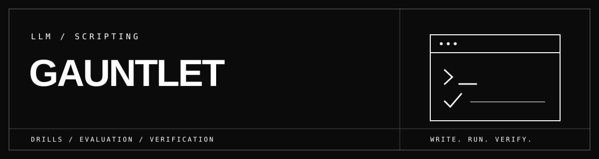
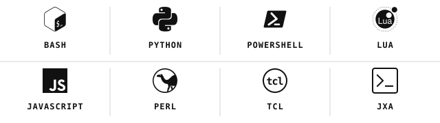

<div align="center">



<p><strong>Scripting challenges for LLM agents. Write the script. Prove the answer.</strong></p>

</div>

A first-party challenge and evaluation deck for LLM agents working through
messy data, awkward APIs, file cleanup, logs, host state, and network evidence.
The script can be disposable. The answer has to be right.

## Languages used

<picture>
  <source media="(prefers-color-scheme: dark)" srcset="assets/languages-dark.svg">
  
</picture>

| Where | Languages in the committed solutions |
| --- | --- |
| Shell, text, and embedded work | Bash, Python, Perl, Tcl, Lua |
| Browser DOM | JavaScript, checked locally with jsdom |
| OS scripting | PowerShell; JXA on macOS |

The harness uses the Python 3.11+ standard library. The browser DOM reference
also needs Node and the locked jsdom dependency.

## Run

```sh
make list
python3 harness/run.py run 001-csv-rollup --lang py
npm ci --ignore-scripts
make check
make calibrate ID=001-csv-rollup
```

`make check` needs the interpreters used by the selected solutions and the Node
dependency above. JXA is skipped outside macOS. For a single language, use
`python3 harness/run.py run all --lang py`.

## The drill contract

Each drill has a task prompt, fixtures, an independent verifier, and at least
one reference solution. The runner copies the input into a fresh work
directory, exposes `$IN`, `$OUT`, and `$WORK`, then checks the answer's
behavior. A calibrated drill also has a plausible wrong solution that the
verifier must reject for the intended reason.

| Part | Job |
| --- | --- |
| `PROMPT.md` | The agent-visible task and output contract |
| `drill.toml` | Stable ID, family, difficulty, timebox, and taught skills |
| `fixtures/` | Messy but reproducible input |
| `verify.py` | Independent checks on the result |
| `solutions/` | Known-good implementations |
| `controls/` | Semantic negatives and their expected rejection |

The seven families are data wrangling, API probing, web scraping, file hygiene,
text munging, system reconnaissance, and network reconnaissance. `make list`
is the current inventory.

Start with [CSV rollup](drills/001-csv-rollup), [browser DOM scraping](drills/004-scrape-table),
[macOS plist auditing](drills/149-macos-plist-audit),
[agent permission boundaries](drills/145-agent-permission-boundary), or
[Lua pattern fields](drills/lua/150-lua-pattern-fields).

[Runtime contract](docs/drill-spec.md) ·
[Authoring and admission](docs/authoring-contract.md) ·
[Documentation map](docs/README.md)

Reference calibration is local evidence. It does not by itself prove that a
model learned the task or that a dataset was admitted to a training farm.
